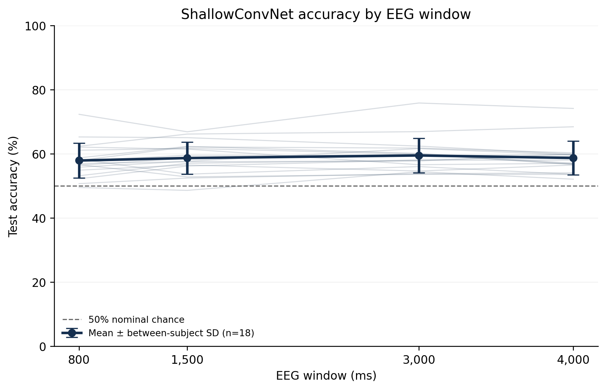
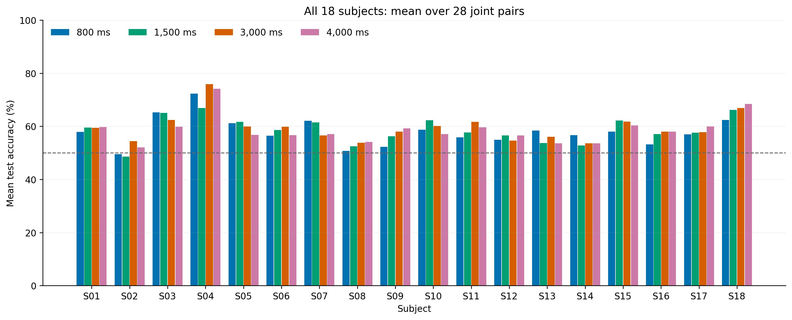
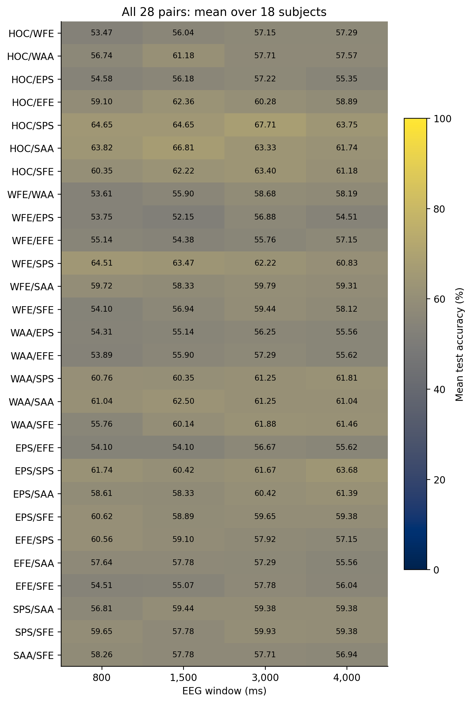
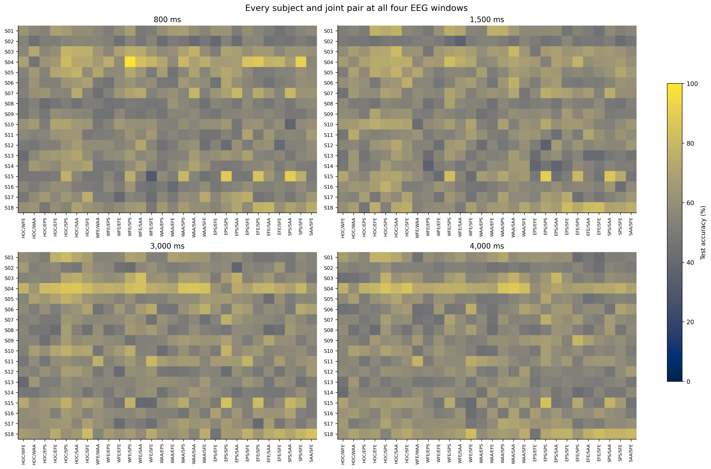

# ShallowConvNet baseline — Perlmutter job 61441374

This package reports one completed run of the repository's unchanged
[`run_shallow_all.py`](../../../run_shallow_all.py), source commit
`b80ade97621197fb5e29994cdfb8045cf15f8471`. All 18 subjects, 28 binary joint pairs,
four EEG windows and five folds completed successfully. It contains 2,016
subject/pair/window accuracy values and 10,080 fold results.

## Results

| EEG window | Samples at 250 Hz | Mean test accuracy |
| --- | ---: | ---: |
| 800 ms | 200 | 57.92% |
| 1,500 ms | 375 | 58.69% |
| 3,000 ms | 750 | 59.50% |
| 4,000 ms | 1,000 | 58.71% |

Values are macro averages over all 18 subjects and 28 pairs, rounded only for
display. Full-precision values remain in the CSV files. All windows are reported;
no window, subject, pair, or fold was excluded. These are descriptive results
from one configured run. They do not by themselves establish significance,
superiority to another model, or numerical agreement with an independently
published benchmark. The same subjects and trials contribute to multiple pairs
and windows, so those measurements are correlated.

## Figures

All figures are available as 240 dpi PNG and vector PDF/SVG with consistent
0–100% accuracy scales. Pair and subject orders are fixed, rather than ranked
by performance. The dashed 50% line is nominal balanced-binary chance, not a
statistical significance threshold.



**Figure 1.** Faint lines are each subject's mean over the 28 pairs. The dark
line averages those 18 subject means. Error bars show the descriptive sample
standard deviation across the 18 subject means, using ddof=1; they are not
confidence intervals, standard errors, or variation across all 504 pair/subject
cells treated as independent observations.



**Figure 2.** Each subject's mean accuracy over 28 pairs at each window. Subject
identifiers are the pseudonymous identifiers used by the original experiment.



**Figure 3.** Pair-specific mean accuracy over 18 subjects, with every pair and
window retained. Cell labels are rounded to two decimal places.



**Figure 4.** All 18 × 28 subject/pair values in each of the four windows; all
panels share one color scale. Each cell pools that subject's five test folds.
Exact values are in `all_pairs_per_subject.csv`.

## Tables

| File in `tables/` | Contents | Origin |
| --- | --- | --- |
| `all_pairs_per_subject.csv` | 2,016 rows: pair, subject, window, accuracy, n_test | Byte-for-byte original |
| `pair_x_window_mean.csv` | 28 pairs × 4 windows, mean over subjects | Byte-for-byte original |
| `subject_x_pair_4000ms.csv` | 18 subjects × 28 pairs at 4,000 ms | Byte-for-byte original |
| `all_pairs_per_fold.csv` | 10,080 rows with test/selected-validation accuracies and test counts | Exact concatenation of the 28 original per-fold tables |
| `subject_x_window_mean.csv` | 18 subjects × 4 windows, mean over pairs | Derived from original accuracies |
| `window_summary.csv` | Macro mean and between-subject SD for each window | Derived from subject means |

All accuracies use percent units. `n_test` counts trials: 16 per fold and 80 per
subject/pair/window across five folds. Derived floating-point values are written
with 17 significant digits. Original summary bytes are preserved, including
floating-point display artifacts inherited from the training output.

## Methodology

The provided `datasetpaper_4_40hz_MIonly` inputs contain 18 subjects with 320
trials each, 62 EEG channels, 1,000 samples per trial, and eight class labels
(40 trials per class). The supplied inputs are described as 4–40 Hz MI-only EEG
at 250 Hz. Filtering and dataset creation are not repeated by this publication
script. Windows use the first 200, 375, 750, or 1,000 samples.

Every unordered pair of the eight script labels (HOC, WFE, WAA, EPS, EFE, SPS,
SAA, SFE) forms a balanced binary task. Evaluation is within subject, not a
held-out-subject or cross-subject transfer experiment. For each subject,
`subject_splits` creates five shuffled, class-stratified folds on all eight
classes, using `random_state=42 + subject_id`. From each fold's training/validation
pool, a stratified 25% is held out for validation with that same random state.
The pair then selects only its two classes from these fixed splits: 24 training,
8 validation and 8 test trials per class. Every trial is tested once across
the five folds. These splits are shared across windows and pairs.

Per-channel z-scoring uses training statistics only. A noisy copy of training
trials is appended using the original Gaussian-noise level 0.15 times each
channel's standard deviation. Validation and test data are not augmented.
The model is the original script's ShallowConvNet: 40 temporal filters of length
25, a spatial convolution across 62 channels with 40 filters, batch normalization,
squaring, average pooling (length 75, stride 15), log with a 1e-6 floor, dropout
0.5, flattening, and a two-output linear classifier. Its classifier size adapts
to each window using the original constructor.

Every model trains for 50 epochs with batch size 32, cross-entropy loss and Adam
(lr=0.001, weight_decay=1e-4). ReduceLROnPlateau monitors validation loss with
factor=0.5 and patience=5. Model selection uses highest validation accuracy,
with lower validation loss breaking ties. Test predictions are obtained only
from the selected model. Subject/pair/window accuracy pools the five held-out
test folds (80 trials). All folds have equal test counts, so the mean fold
accuracy also equals that pooled accuracy up to floating-point rounding.
The complete run comprises 10,080 model fits and 504,000 training epochs.

Seed 42 and the original subject/fold/window seed formulas were retained.
`PYTHONHASHSEED=42` and `CUBLAS_WORKSPACE_CONFIG=:4096:8` were set before Python
started. cuDNN deterministic mode was enabled, cuDNN benchmarking disabled, and
`torch.use_deterministic_algorithms(True, warn_only=False)` enforced. The exact
seed formulas and software versions are recorded in `provenance.json`.
Deterministic kernel checks passed at every window; a separate complete rerun
for bitwise reproducibility has not been performed.

## GPU configuration and runtime

| Setting | Observed value |
| --- | --- |
| System | NERSC Perlmutter |
| GPU | 1 × NVIDIA A100-SXM4-40GB |
| Account and queue | `m4431_g`; requested `shared`, resolved `gpu_shared` |
| Constraint | `gpu&hbm40g` |
| CPU and memory | 1 node, 1 task, 32 logical CPUs / 16 physical cores, 55 GiB host RAM |
| CPU binding / library threads | cores / 16 |
| Environment module | `pytorch/2.8.0` |
| Python / PyTorch | 3.12.11 / 2.8.0+cu129 |
| CUDA / cuDNN | 12.9 / 9.10.2 |
| NumPy / pandas / scikit-learn | 2.1.2 / 2.3.3 / 1.7.2 |
| Training job | 61441374, COMPLETED, exit code 0:0 |
| Total allocated batch runtime | 05:46:27 (20,787 seconds) |
| Training Python step runtime | 05:46:12 (20,772 seconds) |
| Script-reported 28-pair loop | 346.1 minutes (rounded by the script) |
| Prior validation job | 61441331, COMPLETED, exit code 0:0, 30 seconds |
| Requested walltime limit | 48 hours; actual elapsed time is reported above |

The preceding GPU validation checked every dataset payload for finite values,
all subject/pair splits, one visible A100, and deterministic forward/backward
kernels for the unchanged model at each window. Synthetic fixture values used
only to test checkpoint reuse are excluded from every published result.
No EEG or GPU training was run on a login node while preparing this package.

## Regeneration and verification

Plotting needs only NumPy, pandas and Matplotlib. The figure-generation environment
was NumPy 2.1.2, pandas 2.3.3, Matplotlib 3.10.6. It does not import either training
script and needs no EEG files, PyTorch, GPU, Slurm allocation, or checkpoints.
From the repository root, using Python with those plotting dependencies:

```bash
python scripts/prepare_shallowconvnet_publication.py
python scripts/prepare_shallowconvnet_publication.py --verify-only
```

The first command regenerates derived tables and all figure formats from the
included accuracy tables. The second is read-only and checks coverage, numerical
relationships, and the published artifact hashes. To additionally compare with
the untouched original output on Perlmutter:

```bash
python scripts/prepare_shallowconvnet_publication.py --verify-only   --source-results /pscratch/sd/a/anis/shallowconvnet/data/mi_cmp_baseline
```

The three original summary CSVs were checked byte-for-byte. All combined
subject and fold values were checked exactly against their individual pair
files. Pair matrices were compared against each original wide CSV and result
JSON. Summary and pooled-fold calculations use absolute tolerance 1e-12
percentage points, rtol=0. All 115 source metric files have hashes in
`original_output_sha256.json`. `verification.json` records these checks;
`SHA256SUMS` covers the publication artifacts. Both original training scripts
remain byte-identical to the source revision; the baseline source SHA-256 is:

`e2ea42c2db7f0861caaaece7042bd81c69fd54b9555b3b6dbdb90db7463fec2e`.

## Retention and scope

A verified private HOME archive outside scratch retains all 648 original result
files (including metric/prediction checkpoint pickles). It was checked file by
file using SHA-256 before publication. The public package includes only small
accuracy tables, figures, documentation, provenance and preparation code.
EEG arrays, binary checkpoints, full execution logs and unrelated environment
packages are not uploaded. Published results contain no raw EEG.

The HOME backup is on Perlmutter's permanent home filesystem, not an off-site
archive. A verified publication Git bundle is also retained outside scratch.
No new model was trained and no evaluation setting was changed during packaging.
